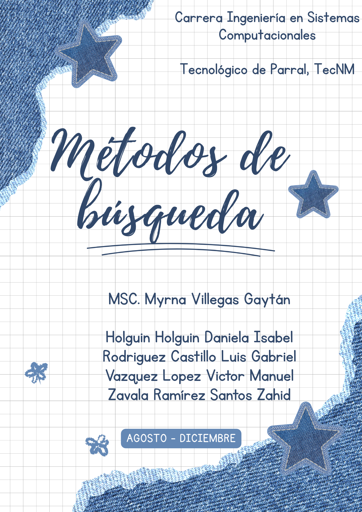

# PaginaWeb

La página tiene como objetivo presentar información sobre los principales conceptos, mecanismos y herramientas que permiten proteger los sistemas informáticos y mantener segura la información.
# Métodos de Busqueda

**Integrantes:**

Holguin Holguin Daniela Isabel

Rodriguez Castillo Luis Gabriel

Vazquez Lopez Victor Manuel

Zavala Ramírez Santos Zahid

**Carrera:** Ingeniería en Sistemas Computacionales

**Semestre:** 3.er semestre

**Materia:** Estructura de datos

**Docente:** Mtra. Myrna Villegas Gaytán

## Descripción
Este repositorio contiene una pagina web en html
